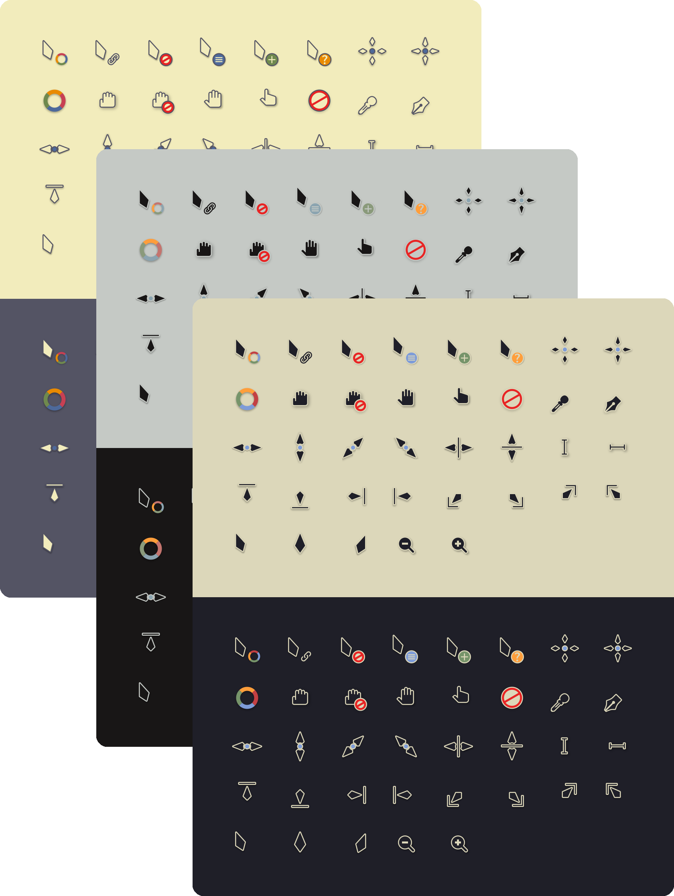
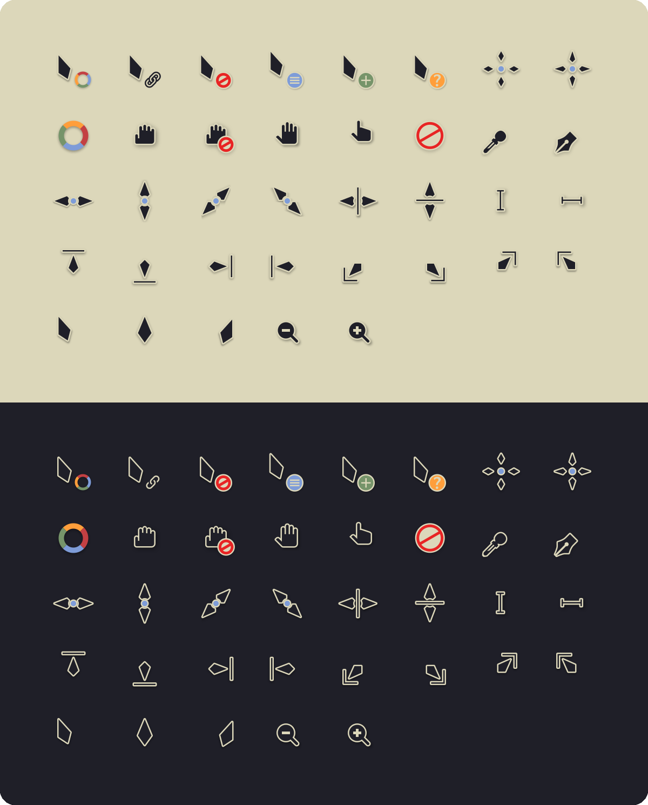
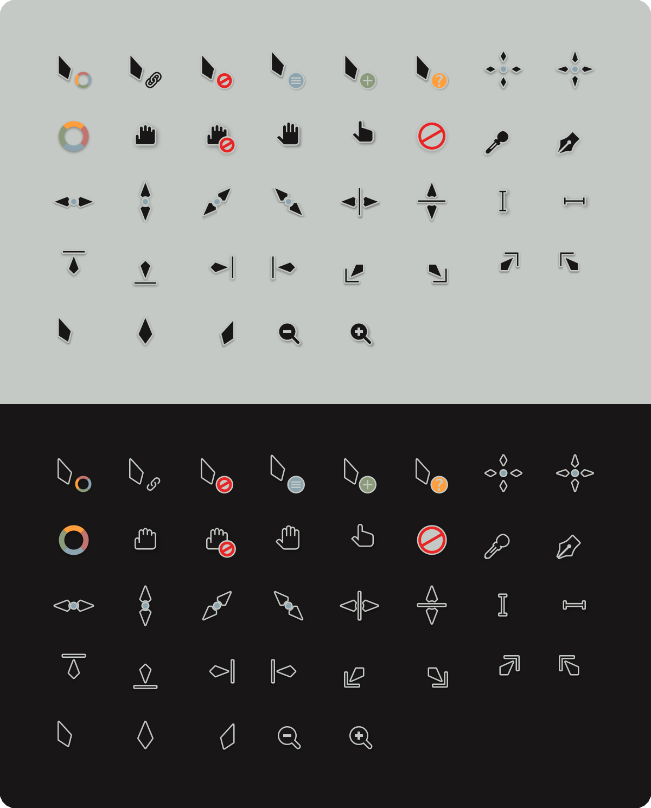
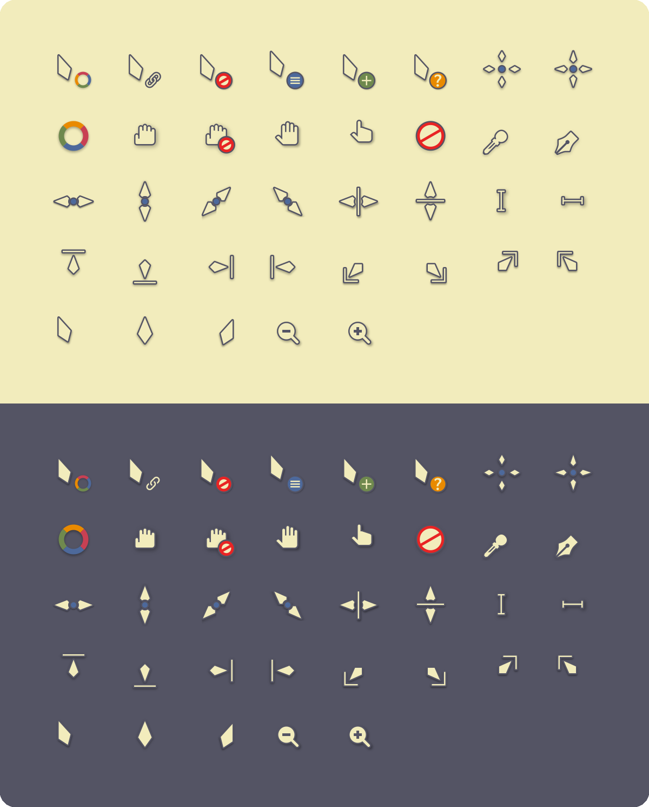

<h3>Kanagawa cursors</h3>
<p>A community-maintained theme inspired by Hokusai's <em>The Great Wave off Kanagawa</em>.</p>
<p>Using the <a href="https://github.com/rebelot/kanagawa.nvim">Kanagawa palette</a> by <a href="https://github.com/rebelot">Tommaso Laurenzi (rebelot)</a>.</p>
<p>Based on <a href="https://github.com/vinceliuice/Vimix-cursors">Vimix cursors</a> by <a href="https://github.com/vinceliuice">Vince Liuice</a>, itself based on <a href="https://github.com/keeferrourke/capitaine-cursors">Capitaine cursors</a> by <a href="https://github.com/keeferrourke">Keefer Rourke</a>.</p>

<br clear="both">

<!-- Wave accents: carpYellow, crystalBlue, autumnRed. Lotus accents: lotusYellow, lotusBlue4, lotusRed. -->
<p align="center">
  <a href="https://github.com/kanagawa-community/cursors/stargazers">
    <picture>
      <source media="(prefers-color-scheme: dark)" srcset="https://img.shields.io/github/stars/kanagawa-community/cursors?style=for-the-badge&amp;labelColor=1F1F28&amp;color=E6C384">
      <source media="(prefers-color-scheme: light)" srcset="https://img.shields.io/github/stars/kanagawa-community/cursors?style=for-the-badge&amp;labelColor=F2ECBC&amp;color=77713F">
      
    </picture>
  </a>
  <a href="https://github.com/kanagawa-community/cursors/releases/latest">
    <picture>
      <source media="(prefers-color-scheme: dark)" srcset="https://img.shields.io/github/v/release/kanagawa-community/cursors?style=for-the-badge&amp;label=release&amp;labelColor=1F1F28&amp;color=7E9CD8">
      <source media="(prefers-color-scheme: light)" srcset="https://img.shields.io/github/v/release/kanagawa-community/cursors?style=for-the-badge&amp;label=release&amp;labelColor=F2ECBC&amp;color=4D699B">
      
    </picture>
  </a>
  <a href="https://github.com/kanagawa-community/cursors/issues">
    <picture>
      <source media="(prefers-color-scheme: dark)" srcset="https://img.shields.io/github/issues/kanagawa-community/cursors?style=for-the-badge&amp;labelColor=1F1F28&amp;color=C34043">
      <source media="(prefers-color-scheme: light)" srcset="https://img.shields.io/github/issues/kanagawa-community/cursors?style=for-the-badge&amp;labelColor=F2ECBC&amp;color=C84053">
      
    </picture>
  </a>
</p>

<br>

## Previews



<details>
<summary>🌊 Wave</summary>

</details>

<details>
<summary>🐉 Dragon</summary>

</details>

<details>
<summary>🪷 Lotus</summary>

</details>

## Requirements

- Any desktop that reads X cursor themes: KDE Plasma, GNOME, Hyprland, Sway and others.

## Installation

Clone the repository and run the install script. It copies the themes into `~/.icons`:

```sh
git clone https://github.com/kanagawa-community/cursors
cd cursors
./install.sh
```

`./install.sh` installs all three variants. Name the ones you want instead, for
example `./install.sh dragon lotus`. Run it again after `git pull` to update.
`./uninstall.sh` takes the same names and removes them.

The script uses `~/.icons`, not `~/.local/share/icons`: KDE Plasma's cursor settings do
not list cursor themes from the second folder, and the global theme cannot apply them
from there.

## Usage

In KDE Plasma, pick **Kanagawa Wave** in **System Settings > Colors & Themes >
Cursors**. The [Kanagawa global theme](https://github.com/kanagawa-community/kde) selects
it for you. On other desktops, set the cursor theme to `Kanagawa-Wave` the way your
desktop expects, for example `gsettings set org.gnome.desktop.interface cursor-theme
Kanagawa-Wave`.

## Palette

The cursors are Vimix cursors with every color replaced by a role from the shared
[palette](https://github.com/kanagawa-community/.github/blob/main/docs/PALETTE.md), so
each variant uses its own value for the same role. Dark variants use Vimix's dark
cursors, light variants its white ones.

| Cursor part                  | Palette role                                         |
| ---------------------------- | ---------------------------------------------------- |
| Body                         | `ui.bg`                                              |
| Outline, symbols             | `ui.fg`                                              |
| Inner details, light parts   | `ui.bg_m3`, `ui.fg_dim`                              |
| Resize dots                  | `syn.fun`                                            |
| Help badge                   | `diag.warning`                                       |
| Copy badge                   | `term.green`, `syn.string`                           |
| Not allowed, no drop, pirate | `diag.error`                                         |
| Busy and progress spinner    | accent pairs, from `syn.special3` to `syn.statement` |

The drop shadow stays black. `scripts/generate.py` holds the full list.

## Issues and contributions

Report bugs and request changes in this port's
[issue tracker](https://github.com/kanagawa-community/cursors/issues). Contributions are welcome.

See [CONTRIBUTING.md](CONTRIBUTING.md) before opening a pull request.

## License

GPL-3.0, like Vimix cursors. See [LICENSE](LICENSE). Each theme in `themes/` carries a
copy of the license, since it is installed on its own.

The cursor shapes in the `upstream/` submodule are [Vimix cursors](https://github.com/vinceliuice/Vimix-cursors)
by Vince Liuice (GPL-3.0), unchanged from commit
[`9bc292f`](https://github.com/vinceliuice/Vimix-cursors/tree/9bc292f). Vimix cursors are
based on [Capitaine cursors](https://github.com/keeferrourke/capitaine-cursors), copyright
2016 Keefer Rourke and others (LGPL-3.0), which are based on the KDE Breeze cursors.

Kanagawa Community contributors modified this work in November 2026 and later: the themes
in `themes/` are the cursors in `upstream/src/` with their colors replaced by
`scripts/generate.py`, built with that script instead of Vimix's `build.sh`. Git
history records every change.
